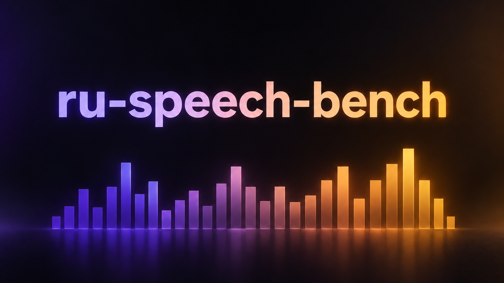

<p align="center">
  
</p>

<h1 align="center">ru-speech-bench</h1>

<p align="center"><b>Практический бенчмарк 21 речевого движка для русского языка: синтез, распознавание и определение конца реплики. Скрипты, сырые цифры и лицензии.</b></p>

<p align="center">
  
  
  
  
  
</p>

<p align="center">
  <a href="#результаты">Результаты</a> ·
  <a href="#лицензии-прочитайте-до-запуска-в-продукт">Лицензии</a> ·
  <a href="#как-воспроизвести">Воспроизвести</a> ·
  <a href="README.md">English</a>
</p>

---

## Зачем

Бенчмарки речевых моделей в основном английские, а в русских редко сказано, на каком железе снята цифра, под какой лицензией веса и
что сломалось при установке. Этот репозиторий — журнал реального проекта, которому нужен был русскоязычный телефонный голосовой агент
([ru-voice-agent](https://github.com/meshoklv/ru-voice-agent)): каждый движок поставили, прогнали на русском тексте, измерили и описали с граблями.

- **Только цифры из реальных прогонов**, у каждой указано железо. Где не мерили — так и написано.
- **Лицензии сверены со страницей первоисточника** (в каждой карточке дата). Некоммерческие веса помечены, а не спрятаны.
- **Скрипты приложены**: любую цифру можно повторить у себя на своих референсных голосах и записях.

> [!NOTE]
> Замеры сняты в сентябре 2026 на двух машинах: виртуалка с 8 vCPU Xeon E5-2695 v2 (только CPU, без AVX2) и десктоп с RTX 3090 Ti
> (Windows 11). Цифры сопоставимы только внутри одного железа, а не между строками.

## Результаты

### Синтез речи (TTS)

Скорость дана так, как её снимал конкретный прогон. RTF = время синтеза / длительность звука (меньше 1 — быстрее реального времени).

| Движок | Где считается | Скорость | Качество на русском | Лицензия весов, коммерция |
|---|---|---|---|---|
| [Piper](docs/engines/piper.md) (denis / dmitri / irina / ruslan) | CPU, 8 vCPU Xeon | RTF 0,20–0,65 | ровный темп, без щелчков (на слух); числа и даты нужно разворачивать | данные голосов: CC0 (denis, dmitri), неизвестно (irina), **CC BY-NC-SA (ruslan)**; рантайм GPL-3.0; коммерция не проверена |
| [Kokoro-82M](docs/engines/kokoro.md) (русский через espeak) | CPU / 5950X / 3090 Ti | RTF 0,76 (Xeon), 0,2 (5950X), 0,05 (GPU) | разборчиво, живо; официально русского нет, ударения иногда мимо | Apache-2.0, да |
| [Kokoro-RU](docs/engines/kokoro.md) | CPU 5950X | ~1,2 с на 7 с звука | авторы заявляют WER 2,50 % (не воспроизводили) | OpenRAIL, не проверено |
| [Chatterbox Multilingual](docs/engines/chatterbox.md) | CPU Xeon | RTF 22–24 (на CPU непригоден) | слова ок, цифры искажает; клон 0,80–0,82 | MIT, да (водяной знак в звуке) |
| [Qwen3-TTS 1.7B](docs/engines/qwen3-tts.md) | RTX 3090 Ti | RTF 2,8–3,3 | 4 из 5 фраз дословно, клон «протекает» референсом | Apache-2.0, да |
| [ESpeech-TTS-1 RL-V2](docs/engines/espeech-tts.md) | RTX 3090 Ti | RTF 0,17–0,36, первый кусок 1,1–1,5 с | 6 из 6 дословно, ударения автоматически, близкий клон | Apache-2.0 заявлена, лицензия базы не проверена |
| [XTTS-v2](docs/engines/xtts-v2.md) | RTX 3090 Ti | RTF ~0,5, первый звук 0,47–0,53 с (стрим) | WER 6,4 % (без чисел), сходство клона 0,58–0,69 | **CPML, некоммерческая** |
| [F5-TTS, русский файнтюн](docs/engines/f5-tts-russian.md) | RTX 3090 Ti | RTF ~0,2–0,3, 1,1–3,1 с до звука | WER 3,2 % (без чисел), лучший клон 0,70–0,75 | **CC BY-NC 4.0** |
| [Fish Audio](docs/engines/fish-audio.md) (облако) | облако | первый звук ~1,0 с лучший, 1,7–3,7 с обычно, до 32,9 с | живее локальных (разброс тона 4,71 против 2,14 полутона) | условия API не проверены; открытые веса **CC-BY-NC-SA** |
| [kie.ai TTS](docs/engines/kie-ai-tts.md) (Gemini TTS через агрегатор) | облако | 6–22 с на фразу, без стрима | разборчиво | условия не проверены |
| [CosyVoice 3](docs/engines/cosyvoice3.md) | RTX 3090 Ti | не мерили | русский не подтверждён | Apache-2.0, да |
| [IndexTTS-2](docs/engines/indextts2.md) | не запускали | — | нет русского препроцессора текста | **собственная лицензия bilibili** |

### Распознавание речи (STT)

Размеченного человеком эталона в репозитории нет, поэтому колонка качества — **расхождение между движками, а не WER**.

| Движок | Где считается | Скорость | Качество | Лицензия |
|---|---|---|---|---|
| [T-one](docs/engines/t-one.md) | CPU, 1 поток | RTF 0,31 офлайн, стрим кусками по 300 мс за ~100–123 мс | расхождение 20–22 % на чистом (WER вендора 19,4 % с ЯМ); нет латиницы и цифр | Apache-2.0, да |
| [GigaAM-v3](docs/engines/gigaam-v3.md) (через [sherpa-onnx](docs/engines/sherpa-onnx.md)) | CPU, 4 потока | медиана 12,8 с на файл 7–130 с под нагрузкой | 9,4 % до консенсуса (наибольшее из 8); WER вендора 8,4 % | MIT, да |
| [Gemini с аудио](docs/engines/cloud-stt-gemini.md) через агрегатор | облако | flash 12–17 с, pro 44–61 с на файл | 7,0–8,6 % до консенсуса на 7 записях | хостинг: не проверено |

Полная таблица облако против локального: [stt/cloud-compare/SUMMARY.md](stt/cloud-compare/SUMMARY.md) (на английском).

### Определение конца реплики

| Движок | Где считается | Скорость | Заметки | Лицензия |
|---|---|---|---|---|
| [Silero VAD 6.2.1](docs/engines/silero-vad.md) | CPU, 1 поток | 0,51–0,58 мс на кусок 32 мс (в 55–62 раза быстрее реального времени) | 8 и 16 кГц дают почти одинаковые границы | MIT, да |
| [Smart Turn v3.2](docs/engines/smart-turn-v3.md) | CPU, 4 потока | ~171 мс на решение | нужны размеченные диалоги для настройки; порог по умолчанию срабатывал слишком часто | BSD-2-Clause, да |

## Лицензии: прочитайте до запуска в продукт

| Движок | Вывод |
|---|---|
| XTTS-v2, F5-TTS (русский файнтюн), открытые веса Fish, голос Piper `ruslan` | **некоммерческие** |
| IndexTTS-2 | собственная ограничительная лицензия |
| Piper (все голоса) | рантайм GPL-3.0; все четыре русских голоса дообучены с английского голоса «только для исследований»: **коммерция не проверена, нужен свой юридический ответ** |
| Fish API, kie.ai, Gemini как сервис | условия вендора, заново не проверялись |
| T-one, GigaAM-v3, Kokoro, Qwen3-TTS, Chatterbox, Silero VAD, Smart Turn, CosyVoice 3 | разрешающие (MIT / Apache-2.0 / BSD-2) по страницам первоисточников; см. карточки |

В каждой карточке указано, откуда и когда прочитана лицензия. Это не юридическая консультация. Подробно: [THIRD_PARTY_NOTICES.md](THIRD_PARTY_NOTICES.md).

## Как воспроизвести

Аудио, веса и референсные голоса в репозиторий не входят. Положите свои (на которые у вас есть права) в `./refs/` и `./models/` и запустите
скрипт из карточки нужного движка. Например, Piper на CPU:

```bash
pip install piper-tts num2words
# скачайте голос с https://huggingface.co/rhasspy/piper-voices (ru/ru_RU/<голос>/medium)
PIPER_VOICES_DIR=./voices OUT_DIR=./out python3 tts/piper/run_all.py
```

> [!WARNING]
> Скрипты почищены перед публикацией и компилируются (`python -m compileall`), но большинство **не запускали заново** после чистки.
> Цифры в таблицах взяты из исходных прогонов. Пути и имена моделей, возможно, придётся поправить.

## Методика

Описана в [docs/methodology](docs/methodology): живость и яркость голоса, проверка синтеза обратным распознаванием, измерение клонирования,
оценка определения конца реплики, почему «расхождение» не WER.

## Как помочь

Добавить движок: скопируйте карточку из `docs/engines/`, укажите лицензию со ссылкой и датой, железо и команду. Особенно ценны цифры
с другого железа. См. [CONTRIBUTING.md](CONTRIBUTING.md).

## Лицензия

Код и документация: [MIT](LICENSE). У движков свои лицензии, см. выше.

Автор: [@meshoklv](https://github.com/meshoklv)
